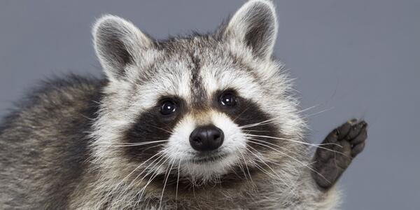

# 너구리

> **너구리**에 대한 사육 가이드 문서입니다.
---
## 종 (Species Overview)

학명: *Nyctereutes procyonoides*  
영명: Raccoon Dog  
분류: 포유강(Mammalia) 식육목(Carnivora) 개과(Canidae) 너구리속(*Nyctereutes*).

### 생김새

- **크기:** 머리부터 몸통까지의 길이는 약 50-68cm이며, 꼬리 길이는 약 13-25cm이다. 개체에 따라 이보다 커지는 경우도 있다.
- **몸무게:** 일반적으로 약 4-8kg이며, 지역과 계절에 따라 차이가 나타난다.
- **외형적 특징:**
  - 몸통이 짧고 통통하며 다리가 짧은 체형을 가지고 있다.
  - 털은 황갈색이나 회갈색을 띠고, 배 쪽은 비교적 밝은색이다.
  - 눈과 뺨 주변에 검은색 털 무늬가 있어 마스크를 쓴 듯 보인다.
  - 귀는 작고 둥글며, 꼬리는 굵고 털이 풍성하지만 라쿤과는 달리 뚜렷한 고리무늬가 나타나지는 않는다.
  - 겨울에는 털이 두꺼워지고 지방이 축적되어 몸집이 더 커 보일 수 있다.
### 수명
- 야생에서의 수명은 약 7-8년으로 알려져 있지만, 야생에서는 서식 환경의 영향을 크게 받으므로 개체별 편차가 큰 편이다.
- 사육 환경에서는 14년 이상 생존한 기록도 보고되어 있다. 모든 개체가 14년 이상 살 수 있는 것은 아니지만 야생에서보다는 오래 살 수 있음을 알 수 있다.

## 사육 방법

너구리는 반려동물보다는 야생동물에 가까우므로 아래 내용은 일반 가정에서 기르는 반려동물용 지침이라기보다는 동물원 등에서 고려하는 관리 원칙에 가깝다.

### 사육 환경 가이드

- **공간 구성:** 사워 환경에 햇볕과 그늘 사이의 균형이 필요하며, 굴이나 은신처 등이 마련되는 편이 좋다.
- **은신처:** 야생에서의 너구리는 은신처를 이용하는 습성을 있으므로, 이를 위해 사람이나 다른 동물들로부터 충분히 몸을 숨길 공간을 제공해야 한다.
- **바닥과 지형:** 자연스러운 이동과 탐색 활동을 할 수 있도록 다양한 지면과 환경 요소를 고려해야 한다.
- **환경 풍부화:** 냄새 탐색, 먹이 찾기, 굴이나 은신처 이용 등 자연스러운 행동을 유도할 수 있는 환경을 마련해야 한다.
- **기후 관리:** 추위와 더위에 대한 반응은 지역과 개체에 따라 다를 수 있으므로, 온도와 습도뿐 아니라 그늘, 바람을 피할 공간, 건조한 휴식 장소 등을 함께 고려해야 한다.

### 기타 특징 
- 너구리와 라쿤을 착각하는 경우가 아주 많은데, 둘은 서로 다른 종이다. 라쿤은 아메리카너구리과에 속하는 종이고, 너구리는 이름과는 달리 개과에 속한다. 외형이 서로 비슷하지만, 너구리는 라쿤보다 주둥이가 짧고 다리가 짧으며, 몸통이 통통하고 털이 풍성한 편이다. 반면 라쿤은 꼬리에 뚜렷한 검은색과 밝은색의 고리무늬가 있고 앞발가락이 길고 발달해 물체를 잡는 데 능숙하다. 너구리는 꼬리는 비교적 짧고, 고리무늬가 뚜렷하게 보이지 않다. 따라서 얼굴의 검은 무늬가 비슷하더라도 꼬리의 무늬와 발의 형태를 통해서 두 종을 구분할 수 있다.
---
## 관련 사이트 및 참고 자료

[한국민족문화대백과사전 - 너구리](https://encykorea.aks.ac.kr/Article/E0012603)
* [Animal Diversity Web - Raccoon Dog](https://animaldiversity.org/accounts/Nyctereutes_procyonoides/)
* [IUCN Red List - Nyctereutes procyonoides](https://doi.org/10.2305/IUCN.UK.2016-1.RLTS.T14925A85658776.en)
* [Wikimedia Commons - 너구리 사진 자료](https://commons.wikimedia.org/wiki/Category:Nyctereutes_procyonoides)
